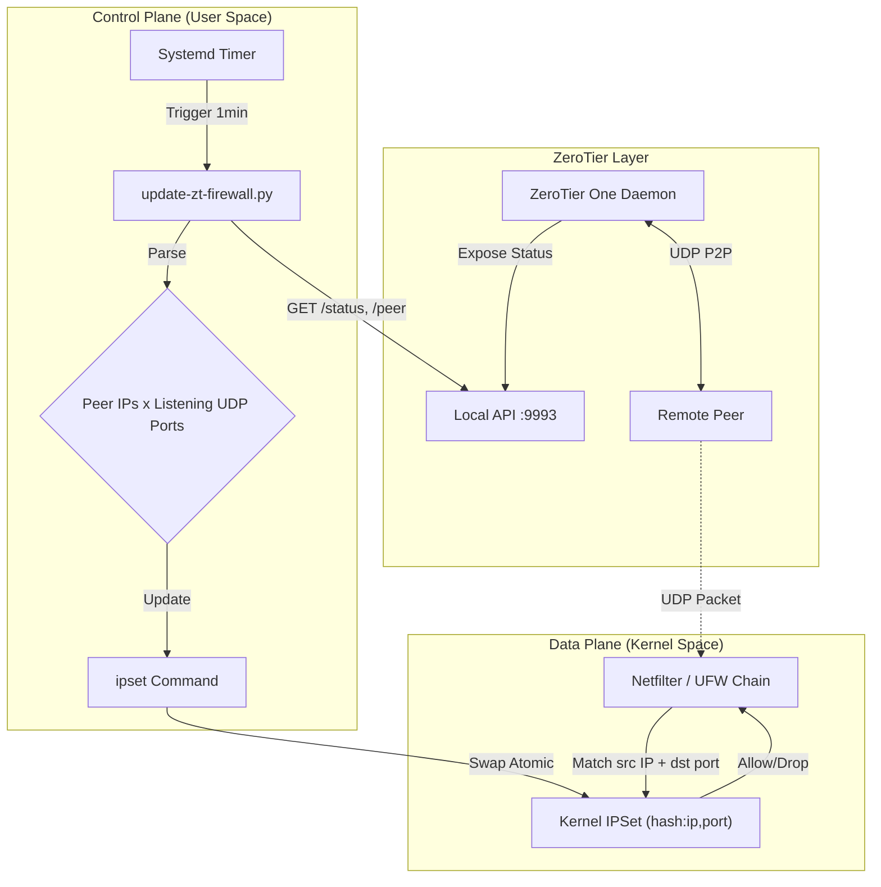

# ZeroTier UDP Puncher


**[日本語](README_ja.md)** | English

**Engineered for Reliability: Dynamic, High-Performance Firewall Hole Punching for ZeroTier**

This tool increases the success rate of ZeroTier P2P (Direct) connections by dynamically managing UFW firewall rules via IPSet. On a Linux host whose firewall drops unsolicited inbound UDP, it lets through the UDP packets that come from the addresses ZeroTier currently knows for its peers, and only when they are addressed to the UDP port(s) ZeroTier itself is listening on. Nothing else is opened.

## Table of Contents
- [Architecture & Data Flow](#️-architecture--data-flow)
- [What Is Allowed, Exactly](#-what-is-allowed-exactly)
- [Key Features](#-key-features)
- [Components & Configuration](#️-components--configuration)
  - [Prerequisites](#prerequisites)
  - [Installation](#installation)
  - [Upgrading from an Older Version](#upgrading-from-an-older-version)
  - [Configuration](#environment-variables-advanced-configuration)
- [Observability & Troubleshooting](#️-observability--troubleshooting)
- [Security Model](#-security-model--why-hashipport)
- [Uninstall](#️-uninstall)
- [License](#-license)

---

## 🏗️ Architecture & Data Flow

Detailed interaction between the system components: ZeroTier, the Python update logic, Systemd timers, and the Kernel's Netfilter subsystem.



## 📋 What Is Allowed, Exactly

Know precisely what the generated rule lets through before relying on it.

*   **Source addresses**: every minute, the script reads `/peer` from the local ZeroTier API and registers the IP address of **every path that is not `expired`, of every peer the daemon lists**. That includes:
    *   ZeroTier's root servers (`PLANET`) and moons (`MOON`), not only `LEAF` peers.
    *   Private addresses (`10.0.0.0/8`, `192.168.0.0/16`, ...), so that direct paths over your LAN work as well.
    *   Paths that are not currently `active` or `preferred`. Hole punching has to let the *first* packet through, so paths cannot be filtered by activity.
    *   Not included: paths marked `expired`, loopback and link-local addresses.

    The tool does **not** check whether a peer is a member of one of your networks. It trusts the peer list that the ZeroTier daemon maintains.
*   **Destination ports**: only the UDP port(s) the local ZeroTier daemon is listening on, read from `/status` (`config.settings.listeningOn`; if absent, `primaryPort` / `secondaryPort` / `tertiaryPort`; if those are absent too, 9993). A registered address can reach no other port, and TCP is never touched.
*   **Rule position**: the rule is inserted into `/etc/ufw/before.rules` (and `before6.rules`) right after UFW's `--ctstate INVALID -j DROP` line, i.e. after loopback, `ESTABLISHED/RELATED` and `INVALID` handling and before UFW's user rules. If that line does not exist, it goes right after `# End required lines`.
*   **Scheduling**: a systemd timer (`zt-firewall-update.timer`) runs the script once a minute (`OnUnitActiveSec=1min`, `AccuracySec=1s`). The script runs once and exits; there is no resident daemon.
*   **Logging**: the service's stdout/stderr go to journald. No log file and no logrotate configuration are created.
*   **Behind CGNAT**: if a peer shares its public IPv4 address with other subscribers of the same ISP (carrier-grade NAT), packets from those subscribers to ZeroTier's port are allowed too. ZeroTier still authenticates every packet it receives; the firewall simply no longer drops them before ZeroTier sees them.

## 🚀 Key Features

### 1. O(1) Packet Filtering Performance
Unlike traditional firewall scripts that append `iptables` rules linearly (O(n) complexity), this tool utilizes **IPSet** (`hash:ip,port` type).
*   **Linear Rules (Bad)**: 100 peers = 100 sequential rule checks for *every* incoming packet.
*   **IPSet (Good)**: 100 peers x 2 ports = **1 hash lookup** (O(1)).
This ensures that CPU load remains negligible even if your ZeroTier network scales to thousands of peers.

### 2. Solved: The Systemd "Boot Loop" Race Condition
A common pitfall in persisting ipsets with UFW is the circular dependency/race condition during boot:
1.  `ufw.service` loads rules.
2.  Rules reference `ipset` sets (e.g., `zt-peers-v4`).
3.  If the sets don't exist yet, **UFW fails to start**.
4.  Standard persistence services often start *after* networking or *in parallel* with UFW, leading to unpredictable boot failures.

**Our Solution**:
We utilize the **UFW `before.init` hook** (`/etc/ufw/before.init`).
This shell script is executed synchronously **immediately before** UFW commands are run. By injecting the `ipset create` commands here, we guarantee:
*   Sets exist *before* any rule references them.
*   Zero dependency on Systemd service ordering.
*   **100% Reboot Safety**.

### 3. Atomic Updates
The Python script updates the IPSet using a **Swap-Describe** pattern:
1.  Create a temporary set (`zt-peers-v4-tmp`).
2.  Populate it with the fresh (IP, port) pairs.
3.  **Atomically swap** the temp set with the live set (`ipset swap`).
4.  Destroy the temp set.
This ensures there is **zero downtime** or "open window" where packets could be dropped during an update.

### 4. Fail-Safe on API Errors
If `/status` or `/peer` cannot be read (ZeroTier not running, HTTP error, unreadable auth token, malformed answer), the script logs the error, leaves both sets exactly as they are and exits with status 1, so the peers that were allowed keep working until the next successful run. Only an empty peer list that the API actually returned empties the sets.

## ⚙️ Components & Configuration

### Prerequisites
*   Linux (Debian/Ubuntu based) with `systemd`, `ufw`, `ipset` and `python3` (**3.7 or later**; the script uses `subprocess.run(capture_output=...)` and `from __future__ import annotations`).
*   ZeroTier One installed and running.

### Installation

```bash
git clone https://github.com/jassdack/zt-udp-puncher.git
cd zt-udp-puncher
chmod +x install_zt_puncher.sh
sudo ./install_zt_puncher.sh
```

### Upgrading from an Older Version
Re-run the installer:

```bash
sudo ./install_zt_puncher.sh
```

Older versions used `hash:ip` sets, whose rule allowed **every** UDP port from a registered address, and inserted the rule at the top of the chain. An ipset cannot change its type in place and `ipset swap` only works between sets of the same type, so when `ipset list -t zt-peers-v4` reports a type other than `hash:ip,port`, the installer migrates:
1.  Remove the old lines from `/etc/ufw/before.rules`, `/etc/ufw/before6.rules` and `/etc/ufw/before.init`.
2.  `ufw reload`, so that no loaded rule references the old sets any more.
3.  `ipset destroy` the old sets.
4.  Continue with the normal installation: create `hash:ip,port` sets under the same names, write the new lines and `ufw reload` again.

**Between step 2 and the final reload, UDP from ZeroTier peers is blocked for a few seconds.** Established ZeroTier sessions recover on their own once the new rules are loaded. The set names, the service name and the timer name do not change.

### Environment Variables (Advanced Configuration)
The core logic is in `/usr/local/bin/update-zt-firewall.py`. The installer overwrites the generated service file on every run, so put overrides in a drop-in instead: `sudo systemctl edit zt-firewall-update.service`, then add `[Service]` and `Environment=NAME=value` lines.

| Variable | Default | Description |
| :--- | :--- | :--- |
| `ZT_API_BASE` | `http://localhost:9993` | Base URL of the local ZeroTier API (`/status` and `/peer` are appended). `ZT_API_URL` of older versions, which pointed at `/peer`, is still accepted. |
| `ZT_TOKEN_PATH` | `/var/lib/zerotier-one/authtoken.secret` | Path to the API authentication token |
| `ZT_TIMEOUT` | `10` | Timeout (seconds) for API calls and subprocs |
| `ZT_IPSET_V4` | `zt-peers-v4` | Name of the IPv4 ipset |
| `ZT_IPSET_V6` | `zt-peers-v6` | Name of the IPv6 ipset |

## 🛠️ Observability & Troubleshooting

### Check Service Status
```bash
systemctl status zt-firewall-update.timer
systemctl status zt-firewall-update.service
```

### Inspect the Firewall State
The rules live in `before.rules`, so they do **not** show up in `ufw status`. Ask iptables and ipset directly:
```bash
# The injected rules (one per address family)
sudo iptables -S ufw-before-input | grep zt-peers
sudo ip6tables -S ufw6-before-input | grep zt-peers

# The (IP, UDP port) pairs currently allowed
sudo ipset list zt-peers-v4
sudo ipset list zt-peers-v6

# What the script would write, without touching the sets
sudo /usr/local/bin/update-zt-firewall.py --dry-run
```

### Logs
Log lines go to stdout/stderr and end up in journald. Nothing is written to a file, so there is no logrotate configuration. A run that changes nothing logs nothing.
```bash
journalctl -u zt-firewall-update.service -f
```

## 🔐 Security Model / Why `hash:ip,port`?
Each set entry pairs one exact IP address with one UDP port (`203.0.113.5,udp:9993`), and the rule matches the packet's **source address and destination port** (`-m set --match-set zt-peers-v4 src,dst`).
*   **Exact addresses, not subnets**: ZeroTier peers often reside on dynamic residential IPs. Whitelisting a whole subnet (`hash:net`, e.g. /24) would expose the port to neighbors or other users on the same ISP node.
*   **Only ZeroTier's own port(s)**: a registered address can reach nothing but the UDP port(s) the local daemon listens on. Earlier versions allowed every UDP port from a registered address; that is why the set type changed (see [Upgrading from an Older Version](#upgrading-from-an-older-version)).
*   **Deliberately broad peer selection**: root servers, private addresses and non-preferred paths are kept on purpose, so that direct paths over a LAN and hole punching (where the first packet must get through) work. Because the destination port is restricted, what is exposed is ZeroTier itself, which authenticates every packet it receives.
*   **Not a membership check**: anything listed in `/peer` is allowed, whether or not it belongs to one of your networks, and behind CGNAT other subscribers sharing the same public address are allowed too. Access to your networks is still governed by ZeroTier's own authorization.

## 🗑️ Uninstall

Cleanly remove all services, timers, scripts, and revert UFW/IPSet configurations:

```bash
sudo ./uninstall_zt_puncher.sh
```

## 📄 License

This project is licensed under the MIT License - see the [LICENSE](LICENSE) file for details.
