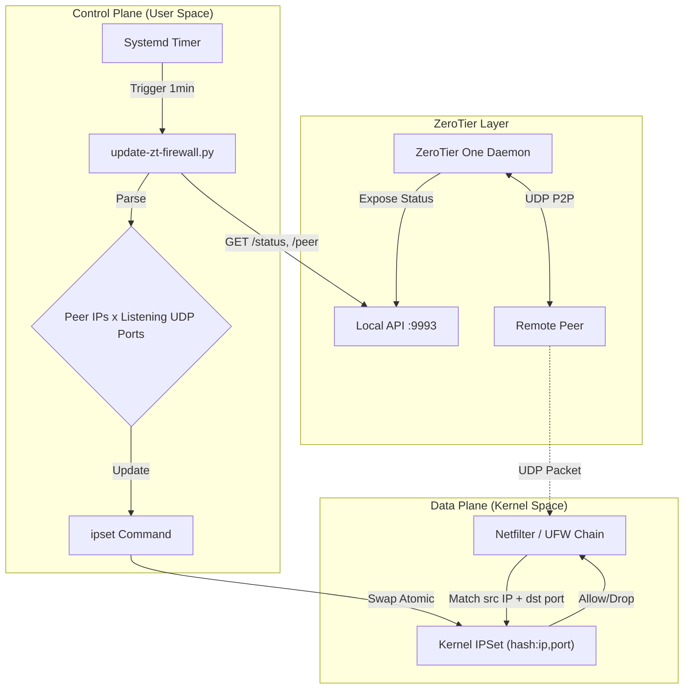

# ZeroTier UDP Puncher


[English](README.md) | **日本語**

**信頼性を重視した設計: ZeroTier のための動的かつ高性能なファイアウォールホールパンチングツール**

このツールは、IPSet を介して UFW ファイアウォールルールを動的に管理することで、ZeroTier P2P (Direct) 通信の成功率を向上させます。外部からの UDP を落とす Linux ファイアウォール環境において、ZeroTier が現在把握している Peer のアドレスから届く UDP パケットのうち、ZeroTier 自身が待ち受けている UDP ポート宛てのものだけを通します。それ以外は何も開放しません。

## 目次
- [アーキテクチャとデータフロー](#️-アーキテクチャとデータフロー)
- [何が許可されるのか](#-何が許可されるのか)
- [技術的観点からの主な特徴](#-技術的観点からの主な特徴)
- [コンポーネントと設定](#️-コンポーネントと設定)
  - [前提条件](#前提条件)
  - [インストール方法](#インストール方法)
  - [旧バージョンからの更新](#旧バージョンからの更新)
  - [環境変数](#環境変数-高度な設定)
- [運用状況とトラブルシューティング](#️-運用状況とトラブルシューティング)
- [セキュリティモデル](#-セキュリティモデル--なぜ-hashipport-なのか)
- [アンインストール](#️-アンインストール)
- [ライセンス](#-ライセンス)

---

## 🏗️ アーキテクチャとデータフロー

システムコンポーネント（ZeroTier、Python 更新ロジック、Systemd タイマー、カーネルの Netfilter サブシステム）間の詳細な相互作用は以下の通りです。



## 📋 何が許可されるのか

このツールに頼る前に、生成されるルールが何を通すのかを正確に把握してください。

*   **送信元アドレス**: スクリプトは1分ごとにローカル ZeroTier API の `/peer` を読み、デーモンが列挙する **すべての Peer の、`expired` でないすべての path** の IP アドレスを登録します。これには次のものが含まれます。
    *   ZeroTier のルートサーバー（`PLANET`）や moon（`MOON`）。`LEAF` だけではありません。
    *   プライベートアドレス（`10.0.0.0/8`、`192.168.0.0/16` など）。LAN 経由の直接経路を通すためです。
    *   現在 `active` でも `preferred` でもない path。ホールパンチングでは *最初の* パケットを通す必要があるため、活動状況で絞ることはできません。
    *   含まれないもの: `expired` の path、ループバックアドレス、リンクローカルアドレス。

    Peer があなたのネットワークのメンバーかどうかは **確かめません**。ZeroTier デーモンが保持している Peer の一覧をそのまま信頼します。
*   **宛先ポート**: ローカルの ZeroTier デーモンが待ち受けている UDP ポートだけです。`/status` から取得します（`config.settings.listeningOn`。無ければ `primaryPort` / `secondaryPort` / `tertiaryPort`、それも無ければ 9993）。登録されたアドレスからでも他のポートには届きませんし、TCP には一切触れません。
*   **ルールの位置**: ルールは `/etc/ufw/before.rules`（および `before6.rules`）の、UFW の `--ctstate INVALID -j DROP` 行の直後に挿入されます。つまり、ループバック・`ESTABLISHED/RELATED`・`INVALID` の処理の後、UFW のユーザールールの前で評価されます。その行が無い場合は `# End required lines` の直後に入ります。
*   **実行方式**: systemd タイマー（`zt-firewall-update.timer`）がスクリプトを1分ごとに実行します（`OnUnitActiveSec=1min`、`AccuracySec=1s`）。スクリプトは一度実行して終了し、常駐するデーモンはありません。
*   **ログ**: サービスの stdout/stderr は journald に送られます。ログファイルは作らず、logrotate の設定もしません。
*   **CGNAT 配下の場合**: Peer が同じ ISP の他の契約者とグローバル IPv4 アドレスを共有している（キャリアグレード NAT）場合、その契約者から ZeroTier のポート宛てに届くパケットも通ります。ZeroTier は受け取るパケットをすべて認証しますので、ファイアウォールが ZeroTier の手前で落とさなくなるだけです。

## 🚀 技術的観点からの主な特徴

### 1. O(1) パケットフィルタリング性能
`iptables` ルールを線形に追加していく従来のスクリプト（計算量 O(n)）とは異なり、本ツールは **IPSet** (`hash:ip,port` タイプ) を利用しています。
*   **線形ルール (非効率)**: 100 ピア = パケットを受信するたびに 100 回のルールチェックが発生。
*   **IPSet (効率的)**: 100 ピア × 2 ポート = **1 回のハッシュルックアップ** (O(1))。
これにより、ZeroTier ネットワークが数千ピアにスケールしても、CPU 負荷は無視できるレベルに保たれます。

### 2. 解決済み: Systemd の「ブートループ」競合状態 (Race Condition)
UFW で ipset を永続化しようとする際によくある落とし穴として、ブート時の循環依存や競合状態があります：
1.  `ufw.service` がルールをロードする。
2.  ルールは `ipset` セット（例: `zt-peers-v4`）を参照している。
3.  セットがまだ存在しない場合、**UFW の起動は失敗する**。
4.  標準的な永続化サービスは、ネットワークの後や UFW と並行して開始されることが多く、予測不能なブート失敗を引き起こす。

**我々の解決策**:
**UFW `before.init` フック** (`/etc/ufw/before.init`) を活用しています。
このシェルスクリプトは、UFW コマンドが実行される **直前に** 同期的に実行されます。ここに `ipset create` コマンドを注入することで、以下を保証します：
*   ルールが参照するよりも *前に* セットが存在すること。
*   Systemd のサービス起動順序に全く依存しないこと。
*   **100% の再起動安全性 (Reboot Safety)**。

### 3. アトミックな更新
Python スクリプトは、**Swap-Describe** パターンを使用して IPSet を更新します：
1.  一時的なセット (`zt-peers-v4-tmp`) を作成。
2.  最新の (IP, ポート) の組を入力。
3.  一時セットと本番セットを **アトミックにスワップ** (`ipset swap`)。
4.  一時セットを破棄。
これにより、更新中にパケットがドロップされる「空白期間」やダウンタイムが **ゼロ** になります。

### 4. API エラー時のフェイルセーフ
`/status` や `/peer` を読めなかった場合（ZeroTier が動いていない、HTTP エラー、認証トークンを読めない、応答の形式が不正）、スクリプトはエラーをログに記録し、両方のセットには一切触れずに終了コード 1 で終了します。それまで許可されていた Peer は、次に成功するまでそのまま通信できます。セットが空になるのは、API が実際に空の Peer 一覧を返したときだけです。

## ⚙️ コンポーネントと設定

### 前提条件
*   Linux (Debian/Ubuntu ベース) で、`systemd`, `ufw`, `ipset`, `python3`（**3.7 以降**。スクリプトは `subprocess.run(capture_output=...)` と `from __future__ import annotations` を使います）が利用可能であること。
*   ZeroTier One がインストールされ、動作していること。

### インストール方法

```bash
git clone https://github.com/jassdack/zt-udp-puncher.git
cd zt-udp-puncher
chmod +x install_zt_puncher.sh
sudo ./install_zt_puncher.sh
```

### 旧バージョンからの更新
インストーラをもう一度実行します：

```bash
sudo ./install_zt_puncher.sh
```

旧バージョンは `hash:ip` タイプのセットを使っており、そのルールは登録されたアドレスからの **すべての** UDP ポートを許可し、チェーンの先頭に挿入されていました。ipset はセットのタイプをその場で変えられず、`ipset swap` も同じタイプどうしでしか使えないため、`ipset list -t zt-peers-v4` の "Type:" が `hash:ip,port` 以外のとき、インストーラは次の手順で移行します：
1.  `/etc/ufw/before.rules`、`/etc/ufw/before6.rules`、`/etc/ufw/before.init` から旧バージョンの行を取り除く。
2.  `ufw reload` を実行し、旧セットを参照するルールが読み込まれていない状態にする。
3.  旧セットを `ipset destroy` で消す。
4.  通常のインストールを続ける：同じ名前で `hash:ip,port` のセットを作り、新しい行を書き込み、再度 `ufw reload` する。

**手順 2 から最後の reload までの数秒間、ZeroTier の Peer からの UDP は通りません。** 確立済みの ZeroTier セッションは、新しいルールが読み込まれれば自然に復帰します。セットの名前、サービス名、タイマー名は変わりません。

### 環境変数 (高度な設定)
コアロジックは `/usr/local/bin/update-zt-firewall.py` にあります。生成された service ファイルはインストーラを実行するたびに上書きされるので、変数を上書きするときは drop-in を使ってください：`sudo systemctl edit zt-firewall-update.service` を実行し、`[Service]` と `Environment=名前=値` の行を追加します。

| 変数名 | デフォルト値 | 説明 |
| :--- | :--- | :--- |
| `ZT_API_BASE` | `http://localhost:9993` | ローカル ZeroTier API のベース URL（`/status` と `/peer` が付け足されます）。旧バージョンの `ZT_API_URL`（`/peer` を指す）も引き続き受け付けます。 |
| `ZT_TOKEN_PATH` | `/var/lib/zerotier-one/authtoken.secret` | API 認証トークンのパス |
| `ZT_TIMEOUT` | `10` | API 呼び出しやサブプロセスのタイムアウト時間（秒） |
| `ZT_IPSET_V4` | `zt-peers-v4` | IPv4 ipset の名前 |
| `ZT_IPSET_V6` | `zt-peers-v6` | IPv6 ipset の名前 |

## 🛠️ 運用状況とトラブルシューティング

### サービスステータスの確認
```bash
systemctl status zt-firewall-update.timer
systemctl status zt-firewall-update.service
```

### ファイアウォール状態の検査
ルールは `before.rules` にあるため、`ufw status` には **表示されません**。iptables と ipset に直接問い合わせます：
```bash
# 注入されたルール（アドレスファミリごとに 1 行）
sudo iptables -S ufw-before-input | grep zt-peers
sudo ip6tables -S ufw6-before-input | grep zt-peers

# 現在許可されている (IP, UDP ポート) の組
sudo ipset list zt-peers-v4
sudo ipset list zt-peers-v6

# セットに触れずに、スクリプトが書き込む内容を表示
sudo /usr/local/bin/update-zt-firewall.py --dry-run
```

### ログ
ログは stdout/stderr に書かれ、journald に届きます。ファイルには書かないので、logrotate の設定はありません。変更が無かった実行では何も記録しません。
```bash
journalctl -u zt-firewall-update.service -f
```

## 🔐 セキュリティモデル / なぜ `hash:ip,port` なのか？
セットの各エントリは、1 つの正確な IP アドレスと 1 つの UDP ポートの組（`203.0.113.5,udp:9993`）で、ルールはパケットの **送信元アドレスと宛先ポート** で照合します（`-m set --match-set zt-peers-v4 src,dst`）。
*   **サブネットではなく正確なアドレス**: ZeroTier ピアは、動的な家庭用 IP 上にあることがよくあります。サブネット全体（`hash:net`、例: /24）をホワイトリストに登録すると、同じ ISP ノード上の近隣住民や他のユーザーに対してポートを開放してしまいます。
*   **ZeroTier 自身のポートだけ**: 登録されたアドレスから届くのは、ローカルのデーモンが待ち受けている UDP ポートだけです。旧バージョンは登録されたアドレスからのすべての UDP ポートを許可していました。セットのタイプを変えたのはそのためです（[旧バージョンからの更新](#旧バージョンからの更新) を参照）。
*   **意図して広くとっている Peer の選び方**: ルートサーバー、プライベートアドレス、preferred でない path は意図して残しています。LAN 経由の直接経路と、最初のパケットを通さなければならないホールパンチングを成り立たせるためです。宛先ポートを限定しているので、さらされるのは ZeroTier 自身であり、ZeroTier は受け取るパケットをすべて認証します。
*   **メンバーシップの確認ではない**: `/peer` にあるものは、あなたのネットワークのメンバーであるかどうかにかかわらず許可され、CGNAT 配下では同じグローバルアドレスを共有する他の契約者も通ります。あなたのネットワークへのアクセスは、引き続き ZeroTier 自身の認可で制御されます。

## 🗑️ アンインストール

すべてのサービス、タイマー、スクリプトを完全に削除し、UFW/IPSet 設定を元に戻します：

```bash
sudo ./uninstall_zt_puncher.sh
```

## 📄 ライセンス

このプロジェクトは MIT ライセンスの下で公開されています。詳細は [LICENSE](LICENSE) ファイルを参照してください。
